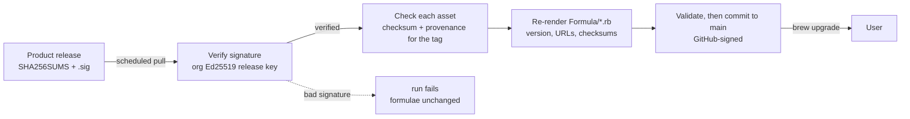

<div align="center">

# Glyndor Homebrew tap

**Homebrew formulae for Glyndor's signed binaries.**
The Homebrew counterpart to the signed apt repository at
[apt.glyndor.net](https://apt.glyndor.net).

[](https://github.com/Glyndor/homebrew-tap/actions/workflows/audit.yml)
[](https://github.com/Glyndor/homebrew-tap/actions/workflows/update.yml)

</div>

## Install

```bash
brew install glyndor/tap/podup
```

Upgrades arrive with `brew upgrade`, like any other formula. The tap looks for
a new release on an hourly schedule, which GitHub often runs late, so a
release is usually served within a few hours.

| Package | What it is | macOS | Linux |
| --- | --- | --- | --- |
| [`podup`](https://github.com/Glyndor/podup) | Docker-compose translator and runner for rootless Podman | this tap | this tap |

On Linux this tap serves the same signed binaries the product publishes for
`x86_64` and `arm64`. Other Glyndor products ship through
[apt.glyndor.net](https://apt.glyndor.net).

## What you are trusting

**The checksum in each formula does not come from the release asset.** It
comes from a `SHA256SUMS` this repository verified against the organisation's
Ed25519 release key first, the same key the products embed. Each asset is also
downloaded and its SHA-256 compared with that manifest, and it must carry build
provenance for the release tag from the product's release workflow, so an old
binary re-published under a new tag is refused even when its signature is valid.

The verifier also accepts a second signature beside the Ed25519 one: an
ML-DSA-65 (FIPS 204) signature over the same `SHA256SUMS`. It is a hybrid and
never a replacement, so the Ed25519 signature is checked first and always, and
the second one is checked whenever the release carries it. No product publishes
that second signature yet, so every release today is admitted exactly as it was
before, and the second signature only starts to protect a release once one
carries it.

`brew` reads this repository straight from GitHub, so there is no separate
server in the path, and a download whose bytes do not match the pinned SHA-256
is refused.



Nothing is pushed here from a product: the tap pulls. The workflow also
accepts a `repository_dispatch` event of type `release`, which starts the same
run ahead of the hourly one. Sending it takes a token with write access to this
repository, and the run reads nothing from the event, so it can bring an update
forward but cannot change what is published. A bad signature fails the run and
leaves the formulae untouched, so the failure mode is a tap that stops
updating, never one that ships an unverified binary.

---

The [threat model](docs/threat-model.md) says what this tap protects, against
whom, and which test holds each control in place.

See [CONTRIBUTING.md](CONTRIBUTING.md). Report a problem via the
[Security](https://github.com/Glyndor/homebrew-tap/security) tab.
[MIT](LICENSE).
